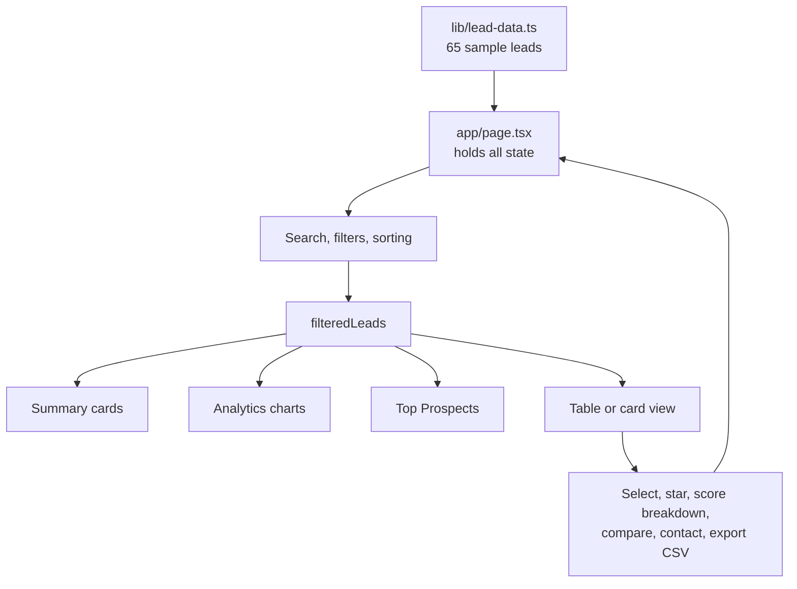

# BioLeads Pro


**A lead intelligence dashboard that tells a biotech business development team who to contact first, and why.**

In biotech sales, not every contact is worth the same effort. BioLeads Pro ranks prospects with a transparent **propensity score from 0 to 100**, broken down into six factors so you can always see *why* a lead scored the way it did. You can search, filter, sort, compare leads side by side, keep a watchlist, contact people in one click, and export your shortlist to CSV.

The scoring is built around one use case: finding drug-safety and toxicology scientists (for example, people working on liver toxicity) who already use, or are likely to be interested in, 3D models and other modern in-vitro methods.

It runs entirely in the browser. There is no backend, database, or API key to set up.

> **About the data:** the 65 leads are sample data created for demonstration. Do not use them for real outreach.

---

## Technologies

- **Framework:** Next.js 16 (App Router), React 19
- **Language:** TypeScript
- **Styling:** Tailwind CSS 4
- **UI components:** shadcn/ui on top of Radix UI
- **Charts:** Recharts
- **Icons:** Lucide React
- **State:** React hooks (`useState`, `useMemo`)
- **Notifications:** shadcn/ui toasts
- **Analytics:** Vercel Analytics

---

## Features

**Lead management**
- 65 sample leads from biotech and pharma companies
- Table view and card view, switchable with one click
- Sortable columns (sorted by rank by default)
- "Top Prospects" cards showing the first six leads in the current view
- Watchlist to star priority leads
- Status badge on each lead (new, contacted, qualified, converted)

**Explainable scoring**
- Every lead has a 0–100 propensity score
- Click any score to see its breakdown across six factors
- A built-in "Scoring Guide" panel explains how the score works
- Leads scoring 70 or above are counted as "High Value"

**Search and filters**
- Search by name, company, job title, or location
- Filter by score range, location, job title, and funding stage
- "Clear all filters" resets everything in one click

**Analytics**
- Summary cards: total leads, average score, high-value leads, and watchlist size
- Charts for score distribution, funding stage, and geographic distribution
- All numbers update live as you filter

**Compare and act**
- Select two or more leads and compare their score breakdowns side by side
- Contact buttons for email, phone, and LinkedIn
- Export selected (or all filtered) leads to CSV

### How the score works

| Factor | Points | What it looks at |
|--------|-------:|------------------|
| Research Activity | 40 | Recent publications on liver toxicity or safety assessment |
| Role Fit | 30 | Job title mentions toxicology, safety, hepatic, or preclinical work |
| Company Intent | 20 | Recent funding, active hiring, growth signals |
| Tech Stack | 15 | Already uses 3D models, NAMs, or in-vitro tools |
| Location | 10 | Based in a major biotech hub (Boston, Bay Area, Basel, Cambridge UK) |
| Engagement | 10 | LinkedIn activity, conference or webinar participation |

The in-app Scoring Guide describes the total as 125 points, normalised to 0–100.

---

## What Users Can Do

1. **Scan** the summary cards and charts to understand the quality of the lead list at a glance.
2. **Review** the Top Prospects cards to see the best-ranked leads first.
3. **Search and filter** to narrow the list, for example "Directors in Basel scoring above 80".
4. **Click a score** to see exactly which factors earned the points.
5. **Open the Scoring Guide** to learn how every factor is defined.
6. **Star leads** to build a watchlist; it appears at the bottom of the page.
7. **Tick checkboxes** on two or more leads, then press **Compare** to see them side by side.
8. **Reach out** by email, phone, or LinkedIn:
   - **Email** opens a draft in your mail app (table and compare view) or lets you copy the address (card view)
   - **Phone** starts a call using your device's dialer
   - **LinkedIn** opens the profile in a new tab
9. **Export** your selected leads, or everything currently filtered, as a CSV file.

---

## Keyboard Shortcuts

BioLeads Pro does not define custom shortcuts. It does support standard keyboard navigation, provided by the Radix UI components it is built on:

| Key | Action |
|-----|--------|
| `Tab` / `Shift + Tab` | Move between buttons, inputs, checkboxes, and rows |
| `Enter` / `Space` | Activate a button or toggle a checkbox |
| `Esc` | Close the Scoring Guide, score breakdown, comparison view, filter panel, or an open dropdown |
| `←` `→` | Switch between Table and Cards view; adjust the score range slider |
| `↑` `↓` | Move through dropdown options |

---

## The Process

Everything flows through one place, `app/page.tsx`, which owns the dashboard's state. Data flows down to the components; user actions flow back up.



1. **Load:** the sample leads are read from `lib/lead-data.ts`.
2. **Filter and sort:** the page applies the search text, score range, location, job title, funding stage, and sort order to produce `filteredLeads`.
3. **Display:** the summary cards, charts, Top Prospects, and table or card view all read from `filteredLeads`, so they stay in sync automatically.
4. **Act:** starring a lead, selecting leads, opening a score breakdown, or comparing leads updates the page state, and the screen updates with it.
5. **Export:** the CSV is generated in the browser from the selected leads, or from all filtered leads if none are selected.

---

## How I Built It

I kept the app simple on purpose: one page, one data file, and small components that each do one job.

- **One source of truth.** `app/page.tsx` holds every piece of state (search, filters, sorting, selection, watchlist). Child components only receive props and report events back.
- **Derived data with `useMemo`.** The filtered list, top prospects, and watchlist are calculated from the state instead of stored separately, so they can never go out of sync.
- **A typed data model.** The `Lead` interface in `lib/lead-data.ts` defines every field, including the six-part `scoreBreakdown`, and uses union types for `fundingStage` and `status`.
- **Explainable by design.** The score is never shown alone: the breakdown modal, the comparison view, and the Scoring Guide all show the same six factors.
- **Reusable UI.** shadcn/ui and Radix UI provide accessible building blocks (dialogs, sliders, dropdowns, tabs), styled with Tailwind CSS.

<details>
<summary><b>Project structure</b></summary>

```
biotech-lead-intelligence-agent/
├── README.md
└── lead-generation-dashboard/
    ├── app/
    │   ├── layout.tsx                 # Root layout, fonts, toast container
    │   ├── page.tsx                   # The dashboard and all of its state
    │   └── globals.css                # Design tokens and global styles
    ├── components/
    │   ├── stats-cards.tsx            # Total, average, high-value, watchlist
    │   ├── analytics-section.tsx      # Three charts
    │   ├── filters-section.tsx        # Search, filter panel, export button
    │   ├── lead-table.tsx             # Sortable table view
    │   ├── lead-card.tsx              # Card view and contact dialog
    │   ├── score-breakdown-modal.tsx  # Per-lead score details
    │   ├── comparison-modal.tsx       # Side-by-side comparison
    │   ├── scoring-legend.tsx         # "Scoring Guide" side panel
    │   └── ui/                        # shadcn/ui components
    ├── hooks/                         # use-toast, use-mobile
    ├── lib/
    │   ├── lead-data.ts               # Lead type, 65 sample leads, filter options
    │   └── utils.ts                   # Helpers
    ├── public/                        # Icons and images
    └── package.json
```

</details>

<details>
<summary><b>Lead data model</b></summary>

```ts
interface Lead {
  id: string
  rank: number
  score: number                       // 0–100
  name: string
  title: string
  company: string
  personalLocation: string
  hqLocation: string
  email: string
  phone: string
  linkedin: string
  fundingStage: "Seed" | "Series A" | "Series B" | "Series C" | "Public"
  lastPublication: string
  publicationTitle: string
  techStack: string[]
  recentActivity: string[]
  scoreBreakdown: {
    roleFit: number                   // max 30
    companyIntent: number             // max 20
    technographic: number             // max 15
    location: number                  // max 10
    scientificIntent: number          // max 40
    engagement: number                // max 10
  }
  isWatched: boolean
  status: "new" | "contacted" | "qualified" | "converted"
}
```

</details>

---

## What I Learned

> Edit these so they sound like you. They are based on how the project is built.

- **Keep state in one place.** Owning all state in a single parent and deriving everything else from it made the filters, charts, and cards stay consistent with very little code.
- **Explainability builds trust.** A score is only useful to a sales team if they can see why a lead ranked high, so the breakdown became a core feature rather than an extra.
- **Design from the user's point of view.** Thinking like a business development rep shaped decisions such as the watchlist, comparison view, and one-click contact actions.
- **Types catch mistakes early.** Defining the `Lead` interface first made every component easier to write and check.
- **Accessible components save time.** Building on Radix UI gave keyboard navigation and focus handling without writing it by hand.

---

## How It Could Be Improved

- **Calculate scores instead of storing them.** Scores and breakdowns are currently typed into the dataset by hand. A scoring function that takes raw signals (title, funding, publications, location) and returns the score would make the model real and testable.
- **Define the scoring weights once.** The maximum points per factor are repeated in `scoring-legend.tsx`, `score-breakdown-modal.tsx`, and `comparison-modal.tsx`. One shared configuration would remove the duplication.
- **Save user actions.** The watchlist and selections reset on page refresh. Saving them (local storage first, a database later) would fix that, and the `status` field could become editable.
- **Connect real data.** Add a CSV import, a CRM integration, or an API as the lead source.
- **Make the sample data more varied.** Almost all current leads are at public companies, so the funding-stage filter and chart show little variation.
- **Finish dark mode.** A theme provider and dark colour tokens exist, but there is no toggle yet.
- **Add tests and tighten the build.** Add unit tests for filtering and scoring, and consider removing `ignoreBuildErrors` from `next.config.mjs`.
- **Handle larger lists.** Add pagination or virtualised rows once there are hundreds of leads.

---

## How to Run

**Prerequisites**
- Node.js **20.9 or higher** (required by Next.js 16)
- npm (comes with Node.js)

Check your versions:

```bash
node -v
npm -v
```

**1. Clone the repository**

```bash
git clone https://github.com/DesaiSakshi1/biotech-lead-intelligence-agent.git
cd biotech-lead-intelligence-agent/lead-generation-dashboard
```

The app lives in the `lead-generation-dashboard` folder, so run every command below from there.

**2. Install dependencies**

```bash
npm install
```

**3. Start the development server**

```bash
npm run dev
```

**4. Open the app** at [http://localhost:3000](http://localhost:3000).

An internet connection is needed the first time so the Inter font can be downloaded.

**Other commands**

| Command | What it does |
|---------|--------------|
| `npm run build` | Create a production build |
| `npm run start` | Serve the production build |

**Adding or changing leads**
- Add an object to the `sampleLeads` array in `lib/lead-data.ts`, following the `Lead` interface above.
- Scores and breakdowns are entered by hand. If you change the maximum points for a factor, update it in `scoring-legend.tsx`, `score-breakdown-modal.tsx`, and `comparison-modal.tsx`.
- Colours and design tokens live in `app/globals.css`.

---

## Demo Video

[](YOUR_VIDEO_URL)

_A short walkthrough: reading the dashboard, filtering leads, opening a score breakdown, comparing leads, and exporting to CSV._
